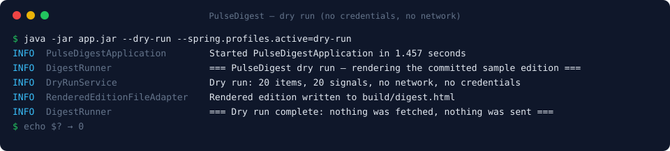

# 🚀 PulseDigest
**Designed and maintained by [Dominik](https://www.linkedin.com/in/dominik-sienkiewicz/), built with AI coding agents:** I set the architecture, write the specifications, define the quality gates enforced in CI and review every change.

Headless batch application that collects tech news from 16 sources twice a week (Mon/Thu), scores items with GPT-4o, **detects cross-source signals** (the same topic surfacing in Science + Code + Business = 🔴 Critical Trend), tracks per-source health, and delivers a tier'd, prioritized digest to your inbox — with a must-know hero block, deals & tools, critical trends, top picks, and signals.


## 📬 What lands in the inbox


*Rendered from the committed test fixture — real markup, synthetic content. Each story appears in
exactly one section; where several sources carried it, `Potwierdzone w:` links each one to its own
coverage instead of repeating the story. The whole document is
[`docs/sample-digest.html`](docs/sample-digest.html); `ReportEmailGoldenFileTest` re-renders the fixture
on every build and fails if a single byte of it changes, so this sample cannot go stale.*

## See it run, without an account

```bash
./gradlew bootJar
java -jar build/libs/app.jar --dry-run --spring.profiles.active=dry-run
```



No API keys, no database, no mail: it renders the same committed edition the golden-file test checks,
through the real builder chain, and writes `build/digest.html` for you to open. Cloning this
repository otherwise ends at "it compiles".

### …or on today's real news, with one key

```bash
OPENAI_API_KEY=sk-... java -jar build/libs/app.jar --spring.profiles.active=preview
```

The whole production pipeline on today's sources — thirteen of the sixteen need no credential —
with a real synthesis, and then the edition written to `build/digest.html` instead of to an inbox and
a database. No Resend account, no Supabase project: the mail and persistence adapters are replaced by
no-ops selected by the profile, so a preview cannot send or store anything whatever is in your
environment. History-backed sections are absent, exactly as they are on a first real run.

## 🧠 The Vision: Signal over Noise
In the era of AI-driven information overload, this tool is my personal solution to maintain situational awareness without manual scrolling. Every collected item gets a 1–10 score and a category; only what clears the threshold reaches the digest, and a topic surfacing in unrelated sources within the same run is flagged as a trend. It's not just a scraper — most of what it collects never reaches the inbox.


## How it works


The boundaries, rather than the source list. The sources themselves:

```
Twitter/X (off, K7)   ──┐
Hacker News             ┤
GitHub                  ┤
RSS feeds (30)          ┤
Reddit (8 subs)         ┤
arXiv                   ┤
GitHub Releases         ┤
Hugging Face Hub        ├─► MarketResearchService ─► GPT-4o synth ──► Supabase save ─► Resend email
Product Hunt            ┤   (parallel fetch,         (score 1-10,
GitHub Advisories       ┤    URL canonicalization,    category, type,
OpenJDK JEP             ┤    2-10 day window)         editorial, PL)
CNCF Landscape          ┤
Tech Radar              ┤
YouTube Conferences     ┤
AI-lab announcements    ┤
Social (Bsky/Mastodon)  ┘
```

Each stage, the full source list, the two-dimensional classification and the reader model
are described in **[docs/how-it-works.md](docs/how-it-works.md)**.

## Documentation

- **What the pipeline does** → **[docs/how-it-works.md](docs/how-it-works.md)** — stages,
  sources, scoring and categorization, and the reader model that adapts over time.
- **What lands in the inbox** → **[docs/digest-email.md](docs/digest-email.md)** — the anatomy
  of the digest and the 👍/👎/zapisz feedback loop that feeds back into scoring.
- **Tuning it** → **[docs/configuration.md](docs/configuration.md)** — every key under the
  `report:` prefix, and which ones accept an environment override.
- **Running and shipping it** → **[docs/running-locally.md](docs/running-locally.md)** — tech
  stack, local setup, Flyway migrations, the GitHub Actions workflows and the watchdog that
  reports an edition that never happened.
- **The decisions, with the mistakes left in** → **[docs/the-build.md](docs/the-build.md)** — why
  a batch and not a service, why `Result<T,E>`, why the model never decides what is important, what
  the feedback loop taught, what was deleted, and what is still wrong.
- **The public archive** → **[docs/archive.md](docs/archive.md)** — every edition republished as a
  static site with an Atom feed and client-side search, and the three layers of checking that keep
  the reader out of it.
- **What it costs** → **[docs/costs.md](docs/costs.md)** — 104 editions a year, one paid
  dependency, which free tiers it leans on and what happens at their limits.
- **Running your own** → **[docs/forking.md](docs/forking.md)** — what to change to point this at
  your own interests, sources, prompt and inbox, and the one thing that needs code.
- **Security** → **[docs/security.md](docs/security.md)** — the trust boundary, what each
  credential can do, the prompt-injection defences that exist, and what is deliberately not
  defended.
- **Design decisions** → **[docs/adr/](docs/adr/README.md)** — seven records, contiguous:
  the product's two languages, hexagonal architecture, the JSONB payload, the hand-rolled OpenAI
  client, the prompt budget, virtual threads over WebFlux, and `Result<T,E>` over exceptions.

## Prerequisites

Three tiers, because what you need depends on how far you want to go:

| To… | You need |
|-----|----------|
| build and test | JDK 26 (Oracle EA or Temurin) + Docker Desktop (Testcontainers) |
| `--dry-run` | nothing else at all |
| `--spring.profiles.active=preview` | an OpenAI API key |
| run the real thing | the above, plus a Resend account and a Supabase project (both free tiers) |

- OpenAI API key — GPT-4o for synthesis, GPT-4o-mini for pre-scoring and the reader-model
  distillation. The only paid credential; see [docs/costs.md](docs/costs.md) for what a month costs.
- Resend account + API key — the delivery channel. Only needed to actually mail someone.
- Supabase project (free tier) — Postgres for report history, feedback and the published record.
- *(Optional)* Product Hunt developer token, YouTube Data API key — without them those two adapters
  degrade gracefully (empty list, a warning, pipeline continues).
- *(Optional)* GitHub token (`GITHUB_API_TOKEN`) — lifts the shared api.github.com limit from 60 requests
  an hour per IP. In GitHub Actions it comes from the automatic `GITHUB_TOKEN`; nothing to create.
- *(Optional)* Twitter/X API v2 bearer token — **not required**: X is kept in the code and switched
  off in `report.sources.disabled` (K7). Set it only if you turn the source back on.
- The feedback receiver is a separate deploy — its source is in [`receiver/`](receiver/README.md),
  and the digest simply renders no 👍/👎 links when `FEEDBACK_RECEIVER_URL` is blank.


## Build commands

```bash
./gradlew clean build      # full build
./gradlew check            # Checkstyle + tests + ArchUnit + JaCoCo coverage gate
./gradlew compileJava      # compile only
./gradlew bootJar          # production JAR → build/libs/
./gradlew test             # unit + integration tests
./gradlew sonar            # SonarCloud analysis (needs SONAR_TOKEN; run after test + jacocoTestReport)
./run.sh                   # run locally (sources .env automatically)
```


## License

[MIT](LICENSE)
