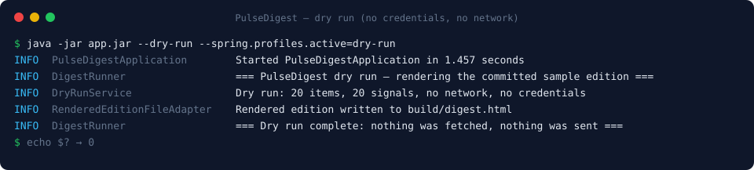
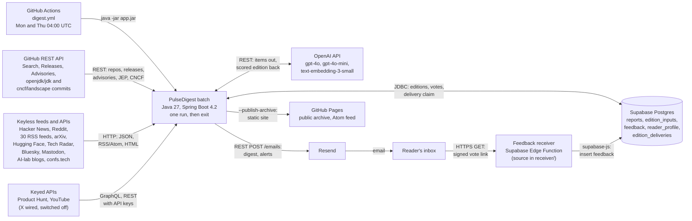
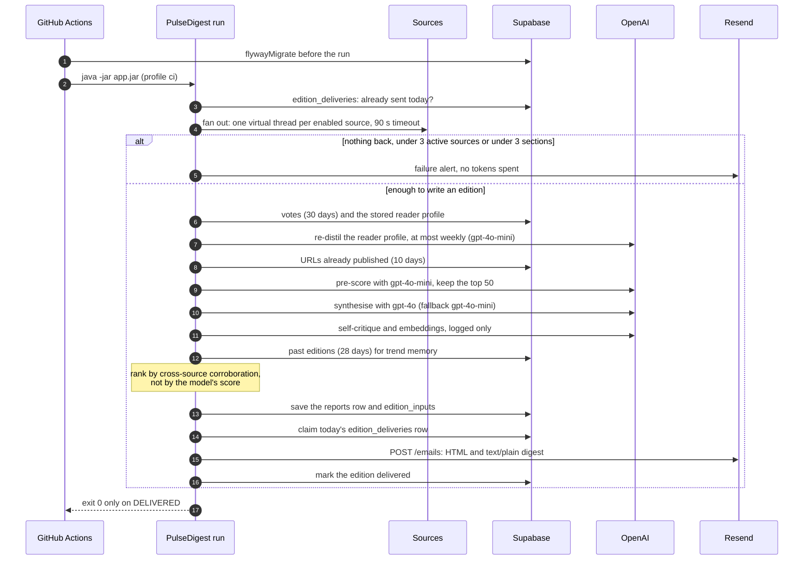
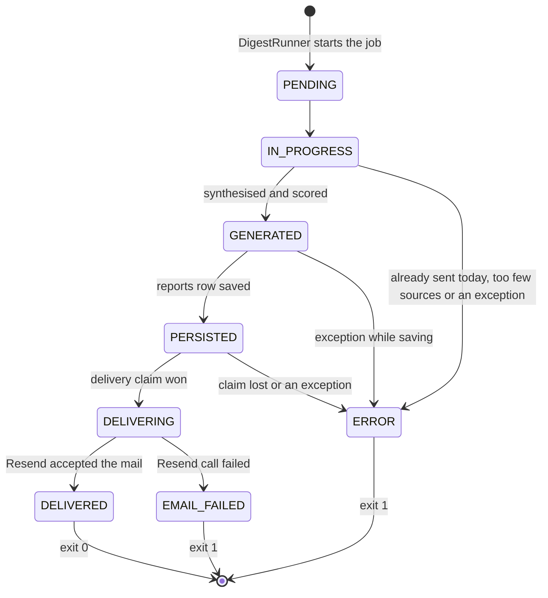
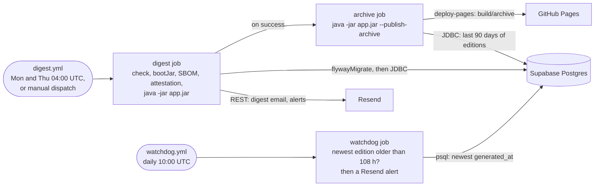

# 🚀 PulseDigest

**Designed and maintained by [Dominik Sienkiewicz](https://www.linkedin.com/in/dominik-sienkiewicz/), built with AI coding agents:** I set the architecture, write the specifications, define the quality gates enforced in CI and review every change.

Headless batch application that collects tech news from 16 sources twice a week (Mon/Thu), scores items with GPT-4o, **detects cross-source signals** (the same topic surfacing in Science + Code + Business = 🔴 Critical Trend), tracks per-source health, and delivers a tier'd, prioritized digest to your inbox — with a must-know hero block, deals & tools, critical trends, top picks, and signals.


[](https://sonarcloud.io/project/overview?id=DominikSienkiewicz_PulseDigest)
[](https://sonarcloud.io/project/overview?id=DominikSienkiewicz_PulseDigest)

## 📬 What lands in the inbox


*Rendered from the committed test fixture — real markup, synthetic content. Each story appears in
exactly one section; where several sources carried it, `Potwierdzone w:` links each one to its own
coverage instead of repeating the story. The whole document is
[`docs/sample-digest.html`](docs/sample-digest.html); `ReportEmailGoldenFileTest` re-renders the fixture
on every build and fails if a single byte of it changes, so this sample cannot go stale.*

## See it run, without an account

```bash
./gradlew bootJar
java -jar build/libs/app.jar --dry-run --spring.profiles.active=dry-run
```



No API keys, no database, no mail: it renders the same committed edition the golden-file test checks,
through the real builder chain, and writes `build/digest.html` for you to open. Cloning this
repository otherwise ends at "it compiles".

### …or on today's real news, with one key

```bash
OPENAI_API_KEY=sk-... java -jar build/libs/app.jar --spring.profiles.active=preview
```

The whole production pipeline on today's sources — thirteen of the sixteen need no credential —
with a real synthesis, and then the edition written to `build/digest.html` instead of to an inbox and
a database. No Resend account, no Supabase project: the mail and persistence adapters are replaced by
no-ops selected by the profile, so a preview cannot send or store anything whatever is in your
environment. History-backed sections are absent, exactly as they are on a first real run.

## 🧠 The Vision: Signal over Noise
In the era of AI-driven information overload, this tool is my personal solution to maintain situational awareness without manual scrolling. Every collected item gets a 1–10 score and a category; only what clears the threshold reaches the digest, and a topic surfacing in unrelated sources within the same run is flagged as a trend. It's not just a scraper — most of what it collects never reaches the inbox.


## How it works


The boundaries, rather than the source list. The sources themselves:

```
Twitter/X (off, K7)   ──┐
Hacker News             ┤
GitHub                  ┤
RSS feeds (30)          ┤
Reddit (8 subs)         ┤
arXiv                   ┤
GitHub Releases         ┤
Hugging Face Hub        ├─► MarketResearchService ─► GPT-4o synth ──► Supabase save ─► Resend email
Product Hunt            ┤   (parallel fetch,         (score 1-10,
GitHub Advisories       ┤    URL canonicalization,    category, type,
OpenJDK JEP             ┤    2-10 day window)         editorial, PL)
CNCF Landscape          ┤
Tech Radar              ┤
YouTube Conferences     ┤
AI-lab announcements    ┤
Social (Bsky/Mastodon)  ┘
```

Each stage, the full source list, the two-dimensional classification and the reader model
are described in **[docs/how-it-works.md](docs/how-it-works.md)**.

## Architecture

PulseDigest is one Spring Boot process that GitHub Actions starts twice a week: it fetches,
writes, sends and exits. Between runs nothing of it is listening; the only component that answers
anything in the meantime is the feedback receiver, a separate Supabase Edge Function whose source
is in [`receiver/`](receiver/README.md).

### What it is made of

Where the data comes from and where it goes: every arrow names the interface it travels over and
what crosses it.



The Maven Central release radar is wired as well, but sends no request with the committed
configuration, because `report.dependency-profile` lists no projects and no coordinates. Every
service, with its switch, is in [Integrations](#integrations).

### One scheduled run, end to end

Read it top to bottom: one Monday or Thursday run, from the cron trigger to the exit code GitHub
Actions reads. Two floors stop a thin run before it spends a token, and a claim in
`edition_deliveries` stops a second send of the same edition.



Self-critique and semantic clustering run in shadow mode (`enforcing: false`): they log what they
would cut or merge and leave the edition unchanged. The rendered edition is also written to
`build/digest.html` before the send, so a failed delivery still leaves it as a run artifact.

### How a run ends

Each run is one job, and its last status becomes the process exit code: only `DELIVERED` exits 0,
which is what the workflow's failure alert hangs off.



An empty or too narrow fetch, and an exception before delivery, also send an alert from the
application itself, naming the accounts to top up when a quota ran out. `EMAIL_FAILED` does not,
because the mail channel is what broke; the workflow's `Notify on failure` step mails on every
exit 1 regardless.

### Where it runs

Everything runs on GitHub Actions: two scheduled workflows, three jobs, and the services each job
touches.



Pull requests and pushes to `main` run the checksum-pinned Gitleaks CLI using `.gitleaks.toml`. It checks the
incoming commits, including files removed before the tip. A new branch, a rewritten history or an unavailable
previous commit triggers a scan of the full history reachable from the new tip. The job reports only the outcome.
The other gates cover merge subjects, Markdown links, shell scripts, workflows, `./gradlew check`, a Flyway
upgrade against Postgres 16, and SonarQube Cloud.

## Integrations

Every external service the code or the workflows call, with its state in `application.yaml` and
the workflows today. The logos only identify the services.

| Service | Used for | Interface | Status |
|---|---|---|---|
|  GitHub Actions | The digest on Mondays and Thursdays at 04:00 UTC, the archive after it, the watchdog daily at 10:00 UTC, and CI on pull requests and pushes to `main` | Workflows in [`.github/workflows/`](.github/workflows/) | On |
| OpenAI | Synthesis (`gpt-4o`, fallback `gpt-4o-mini`); pre-scoring, self-critique and the weekly reader profile (`gpt-4o-mini`); embeddings for semantic clustering (`text-embedding-3-small`); `--discover-sources` on demand | REST `/v1/chat/completions` and `/v1/embeddings`, hand-rolled client ([ADR-0004](docs/adr/0004-hand-rolled-openai-client.md)) | On; self-critique and clustering log only (`enforcing: false`) |
|  Supabase | Postgres for `reports`, `edition_inputs`, `feedback`, `reader_profile` and `edition_deliveries` | JDBC (`JdbcClient`, HikariCP); Flyway migrations in the `digest` job | On; replaced by no-ops under the `preview` profile, untouched by `--dry-run` |
|  Supabase Edge Functions | The feedback receiver: records 👍/👎/zapisz clicks in `feedback` | HTTPS GET signed with HMAC ([`receiver/`](receiver/README.md)) | Deployed separately; no vote links while `FEEDBACK_RECEIVER_URL` is blank |
|  Resend | The digest, failure and quota alerts, the quarterly `--retrospective`; the workflows' failure and watchdog emails | REST `POST /emails` | On |
|  GitHub Pages | Public archive of the editions with an Atom feed | `actions/deploy-pages` in the `archive` job | On, after each scheduled or manual digest that succeeds |
|  GitHub REST API | Trending AI repositories, the latest releases of 17 repositories, HIGH and CRITICAL advisories, JEP changes from `openjdk/jdk` commits, CNCF status changes from `cncf/landscape` commits | REST `api.github.com` with one `GITHUB_API_TOKEN` (the workflow's `GITHUB_TOKEN`) | On |
| Hacker News | Stories matching 22 keywords with a score of at least 40 | Algolia HN Search API | On |
|  Reddit | Top posts of the day in 8 subreddits | REST `/r/{sub}/top.json`, anonymous | On |
|  RSS and Atom feeds | 30 feeds, from InfoQ and the Spring blog to the AWS, Google Cloud and Azure update feeds | HTTP GET, XML parsed with DOCTYPE disabled | On |
|  arXiv | Papers in cs.AI, cs.LG, cs.CR, cs.DC and cs.PL that match the keywords | REST `export.arxiv.org/api/query`, Atom | On |
|  Hugging Face | Trending models in 7 pipelines | REST `/api/models` | On |
|  Product Hunt | Launches with at least 100 votes in 5 topics | GraphQL API v2, developer token | Only with `PRODUCTHUNT_DEVELOPER_TOKEN`; an empty list otherwise |
|  YouTube | New talks on the Spring I/O, Devoxx and CNCF channels | YouTube Data API v3 `search` | Only with `YOUTUBE_API_KEY`; an empty list otherwise |
| Thoughtworks Technology Radar | Entries of volume 34 | JSON from `setchy/thoughtworks-tech-radar-volumes` on raw.githubusercontent.com | On |
|  Bluesky | Posts by 5 handles | Public AppView `app.bsky.feed.getAuthorFeed` | On |
|  Mastodon | 5 hashtags on fosstodon.org | REST `/api/v1/timelines/tag/{tag}` | On |
| AI-lab blogs | Anthropic News and Engineering, the Claude blog, the Google Gemini blog and the OpenAI developer blog | HTML pages parsed per site (embedded Sanity data, JSON-LD) | On |
| confs.tech | Calls for Papers closing within 120 days, in 5 topics | JSON from `tech-conferences/conference-data` on raw.githubusercontent.com | On (`report.call-for-papers.enabled`) |
|  X | Posts by 24 accounts and 4 topic queries | API v2 search, bearer token | Off (`report.sources.disabled`, K7) |
| Maven Central | Release radar for the reader's own dependencies | REST `search.maven.org` | Enabled, but no request: `report.dependency-profile` is empty |
|  SonarQube Cloud | The quality gate and coverage badges above | Gradle `sonar` task in the `sonarcloud` job | When `SONAR_TOKEN` is set |

## Documentation

- **What the pipeline does** → **[docs/how-it-works.md](docs/how-it-works.md)** — stages,
  sources, scoring and categorization, and the reader model that adapts over time.
- **What lands in the inbox** → **[docs/digest-email.md](docs/digest-email.md)** — the anatomy
  of the digest and the 👍/👎/zapisz feedback loop that feeds back into scoring.
- **Tuning it** → **[docs/configuration.md](docs/configuration.md)** — every key under the
  `report:` prefix, and which ones accept an environment override.
- **Running and shipping it** → **[docs/running-locally.md](docs/running-locally.md)** — tech
  stack, local setup, Flyway migrations, the GitHub Actions workflows and the watchdog that
  reports an edition that never happened.
- **The decisions, with the mistakes left in** → **[docs/the-build.md](docs/the-build.md)** — why
  a batch and not a service, why `Result<T,E>`, why the model never decides what is important, what
  the feedback loop taught, what was deleted, and what is still wrong.
- **The public archive** → **[docs/archive.md](docs/archive.md)** — every edition republished as a
  static site with an Atom feed and client-side search, and the three layers of checking that keep
  the reader out of it.
- **What it costs** → **[docs/costs.md](docs/costs.md)** — 104 editions a year, one paid
  dependency, which free tiers it leans on and what happens at their limits.
- **Running your own** → **[docs/forking.md](docs/forking.md)** — what to change to point this at
  your own interests, sources, prompt and inbox, and the one thing that needs code.
- **Security** → **[docs/security.md](docs/security.md)** — the trust boundary, what each
  credential can do, the prompt-injection defences that exist, and what is deliberately not
  defended.
- **Design decisions** → **[docs/adr/](docs/adr/README.md)** — seven records, contiguous:
  the product's two languages, hexagonal architecture, the JSONB payload, the hand-rolled OpenAI
  client, the prompt budget, virtual threads over WebFlux, and `Result<T,E>` over exceptions.

## Prerequisites

Three tiers, because what you need depends on how far you want to go:

| To… | You need |
|-----|----------|
| build and test | JDK 27 (Oracle or Temurin) + Docker Desktop (Testcontainers) |
| `--dry-run` | nothing else at all |
| `--spring.profiles.active=preview` | an OpenAI API key |
| run the real thing | the above, plus a Resend account and a Supabase project (both free tiers) |

- OpenAI API key — GPT-4o for synthesis, GPT-4o-mini for pre-scoring and the reader-model
  distillation. The only paid credential; see [docs/costs.md](docs/costs.md) for what a month costs.
- Resend account + API key — the delivery channel. Only needed to actually mail someone.
- Supabase project (free tier) — Postgres for report history, feedback and the published record.
- *(Optional)* Product Hunt developer token, YouTube Data API key — without them those two adapters
  degrade gracefully (empty list, a warning, pipeline continues).
- *(Optional)* GitHub token (`GITHUB_API_TOKEN`) — lifts the shared api.github.com limit from 60 requests
  an hour per IP. In GitHub Actions it comes from the automatic `GITHUB_TOKEN`; nothing to create.
- *(Optional)* Twitter/X API v2 bearer token — **not required**: X is kept in the code and switched
  off in `report.sources.disabled` (K7). Set it only if you turn the source back on.
- The feedback receiver is a separate deploy — its source is in [`receiver/`](receiver/README.md),
  and the digest simply renders no 👍/👎 links when `FEEDBACK_RECEIVER_URL` is blank.


## Build commands

```bash
./gradlew clean build      # full build
./gradlew check            # Checkstyle + tests + ArchUnit + JaCoCo coverage gate
./gradlew compileJava      # compile only
./gradlew bootJar          # production JAR → build/libs/
./gradlew test             # unit + integration tests
./gradlew sonar            # SonarCloud analysis (needs SONAR_TOKEN; run after test + jacocoTestReport)
./run.sh                   # run locally (sources .env automatically)
```


## License

[MIT](LICENSE)
